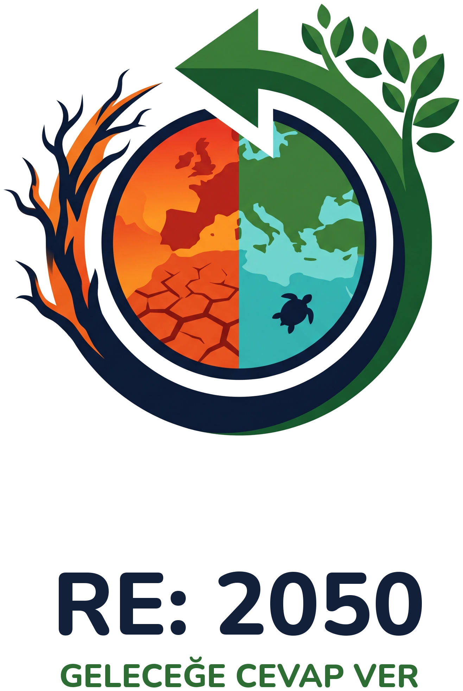
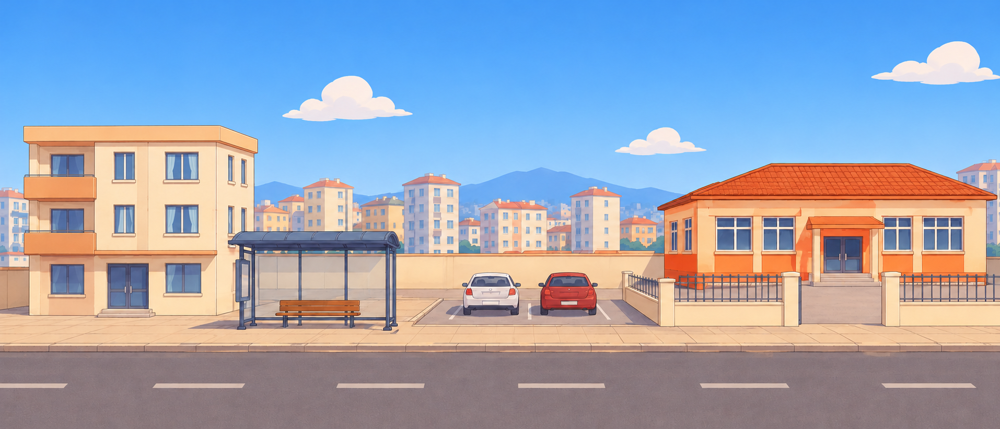
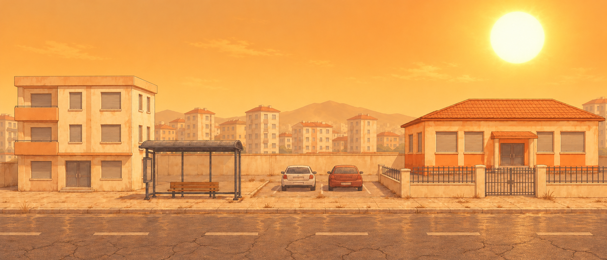

<p align="center">
  
</p>

<h1 align="center">RE: 2050 — Geleceğe Cevap Ver</h1>

<p align="center">
  2050'den gelen mektuplara bugünün kararlarıyla cevap verdiğin, iklim temalı bir mobil strateji oyunu.<br>
  <b>COP31 Oyun Hackathonu</b> için 2 günde Unity ve C# ile geliştirildi.
</p>

<table>
  <tr>
    <th>2026 · Bugün</th>
    <th>2050 · Hiçbir şey yapılmazsa</th>
  </tr>
  <tr>
    <td></td>
    <td></td>
  </tr>
</table>

---

## İçindekiler

- [Oyunun fikri](#oyunun-fikri)
- [Hikâye](#hikâye)
- [Nasıl oynanır?](#nasıl-oynanır)
- [Oyun mekanikleri](#oyun-mekanikleri)
- [Bölümler](#bölümler)
- [Kurtarılmış 2050](#kurtarılmış-2050)
- [COP31 temaları](#cop31-temaları)
- [Bilimsel dayanak](#bilimsel-dayanak)
- [Teknik yapı](#teknik-yapı)
- [Kod mimarisi](#kod-mimarisi)
- [Gelecek planları](#gelecek-planları)
- [Geliştirici](#geliştirici)
- [Kaynaklar ve lisanslar](#kaynaklar-ve-lisanslar)

---

## Oyunun fikri

İklim krizinin en zor anlaşılan yanı, bugün verilen kararların sonuçlarının ancak yıllar sonra ortaya çıkmasıdır. Bugün dikilen bir fidanın gölgesini kimse hemen görmez; bugün dökülen betonun sele dönüşmesi de yıllar alır.

RE: 2050 bu zaman farkını ortadan kaldırır. Oyuncu bir **zaman kaydırıcısıyla 2026 ile 2050 arasında istediği an gidip gelir** ve her kararının 24 yıl sonraki sonucunu anında, kendi gözüyle görür.

**Adın anlamı:** E-postalarda "RE:", bir mesaja verilen cevabı gösterir. Oyunda geleceğin mektubuna bugünden cevap verilir: *RE: 2050*, yani **geleceğe cevap**.

## Hikâye

Yıl 2026. Gelen kutuna tuhaf bir mesaj düşer; gönderen **Deniz**, tarih **12 Temmuz 2050**.

Deniz, senin şu an yaşadığın mahallede, 24 yıl sonra yaşayan genç bir kadındır. Mektuplarında gelecekten haber verir: sokaklar 48 dereceye ulaşmıştır, betona gömülen dere her sağanakta mahalleyi basmaktadır, Antalya kumsalında artık tek bir Caretta yuvası kalmamıştır.

> *"Keşke yıllar önce birileri bir şey yapsaydı. Belki o birileri sensindir."*

**Oyuncu**, bugün o mahallede yaşayan sıradan biridir; kahraman ya da bilim insanı değil, sadece geleceğe ulaşan mektubu eline alan kişidir. Sınırlı bir bütçeyle mahallenin sokağına, deresine ve sahiline hangi müdahalelerin yapılacağına karar verir.

**Amaç**, Deniz'in yaşadığı 2050'yi yaşanabilir kılmaktır: sokağı serinletmek, mahalleyi selden korumak ve kaplumbağa yavrularının yeniden denize ulaşmasını sağlamak. Her başarılı bölümün sonunda Deniz'den bir cevap mektubu gelir.

## Nasıl oynanır?

1. **Mektubu oku.** Her bölüm Deniz'in 2050'den yazdığı bir mektupla başlar.
2. **Geleceği gör.** Sahne 2050'deki haliyle açılır: kavrulmuş bir sokak, sel basmış bir mahalle ya da çöplerle dolu bir kumsal.
3. **Bugüne dön.** Zaman kaydırıcısını 2026'ya çek. Sahnede parlayan yuvalar belirir.
4. **Karar ver.** Alttaki kartları yuvalara sürükle. Her kart yaprak (bütçe) harcar. Bir kartı geri almak için sahnedeki objeye dokun.
5. **Sonucu izle.** Kaydırıcıyı 2050'ye çek. Fidan çınara dönüşür, sel suyu çekilir ya da kaplumbağalar denize koşar; ya da yanlış bir seçim yeni bir soruna yol açar.
6. **Geleceği mühürle.** Hedefe ulaşınca kararlarını mühürle; yıldızlarını, Deniz'in cevabını ve gerçek bir iklim bilgisini al.

## Oyun mekanikleri

### Zaman kaydırıcısı
Oyunun kalbi. Kaydırıcı 2026 ile 2050 arasında serbestçe hareket eder:
- Değişiklikler yalnızca **2026'da** yapılabilir; 2050 sadece izlenir.
- Kaydırırken objeler zaman içinde dönüşür: fidan büyüyerek çınara, yeni bir panel yıllanmış bir panele dönüşür.
- Ölçüt göstergesi (sıcaklık, sel riski, Caretta tehlikesi) 2026'daki değerden oyuncunun kararlarına göre hesaplanan 2050 değerine akar.
- Gelecek kötüyse **müzik boğuklaşır**, sahne turuncuya ya da fırtınaya bürünür. Risk düştükçe müzik açılır ve sahne aydınlanır.

### Bütçe (yapraklar)
Her bölümde sınırlı sayıda yaprak vardır. Her şey alınamaz; oyuncu öncelik belirlemek zorundadır.

### Tuzak kartlar
Oyunun öğretici derinliği buradan gelir. Tuzak kartlar **ucuz, hızlı ve cazip** görünür ama 2050'de yeni bir sorun doğurur. Bazı tuzaklar yaprak harcatmak yerine **yaprak kazandırır**; bu da oyuncuyu gerçek hayattaki gibi "kısa vadeli kazanç" ile sınar.

### Kombolar
Birbirini tamamlayan doğru çözümler birlikte kullanılınca ekstra etki yaratır ve 3. yıldızı kazandırır.

### Yıldızlar
- ⭐ Hedefe ulaşmak
- ⭐ Hiçbir tuzak kartı kullanmamak
- ⭐ En az bir kombo bulmak

### Tek bir doğru yok
Aynı çözüm farklı sorunlarda farklı işe yarar. Örneğin yeşil çatı, Bölüm 1'de (sıcak) serinletmede zayıf kalırken Bölüm 2'de (sel) yağmuru tutarak yıldızlaşır. Oyuncu, iklim çözümlerinin bağlama göre değiştiğini oynayarak öğrenir.

## Bölümler

### Bölüm 1 · Sokak — Sıcak hava dalgası
**Sorun:** 2050'de sokak sıcaklığı 48°C. Durakta beklerken insanlar bayılıyor, okul bahçesi öğlen kapanıyor.
**Hedef:** Sokağı 2050'de 38°C'ye indirmek. **Bütçe:** 7 yaprak.

| Yuva | Doğru seçim | Tuzak |
|---|---|---|
| Otobüs durağı, otopark | **Çınar:** yavaş büyür, kocaman gölge verir | **Palmiye:** hızlı büyür ama gölgesi minicik |
| Okul önü | **Gerçek Bahçe:** çim, toprak ve sebze; çocuklar domates topluyor | **Suni Çim:** güneşte kızgın tavaya döner, zamanla mikroplastiğe dönüşür |
| Apartman çatısı | **Güneş Paneli:** çatıyı gölgeler, temiz elektrik üretir | **Klima:** içeriyi serinletir, dışarıya sıcak hava üfler |

**Kombo:** Çınar + Gerçek Bahçe = **Yeşil Vaha**

### Bölüm 2 · Dere — Ani sel
**Sorun:** Yamaçtaki orman yanmış, dere betonun altına gömülmüş. Bir saatlik sağanak mahalleyi göle çeviriyor.
**Hedef:** Sel riskini %85'ten %45'e indirmek. **Bütçe:** 7 yaprak.

| Yuva | Doğru seçim | Tuzak |
|---|---|---|
| Yanmış yamaç | **Ağaçlandırma:** kökler toprağı tutar, yağmuru emer | **Yamaca Site:** 3 yaprak kazandırır ama yamacı betonla kaplar |
| Teras | **Yeşil Teras:** yağmuru sünger gibi tutar | — |
| Gömülü dere | **Dereyi Aç:** geniş yeşil kıyılar suya yer açar | **Beton Kanal:** dallar ve plastikle tıkanıp taşar |
| Boş arsa | **Geçirgen Zemin:** yağmur toprağa sızar | **Otopark Asfaltı:** suyu hiç emmez |

**Kombo:** Dereyi Aç + Geçirgen Zemin = **Sünger Mahalle**
**Görsel geri bildirim:** Sel suyu, risk düştükçe sokaktan çekilir.

### Bölüm 3 · Sahil — Caretta caretta
**Sorun:** Antalya kumsalında projektörler geceyi gündüze çeviriyor, kumsalın arkasına beton duvar örülmüş, sahil plastikle dolu. Geçen yıl tek bir yuva bile bulunamamış.
**Hedef:** Caretta tehlikesini %90'dan %45'e indirmek. **Bütçe:** 6 yaprak.

| Yuva | Doğru seçim | Tuzak |
|---|---|---|
| Otel önü | **Kaplumbağa Dostu Işık:** alçak, turuncu, yere bakan ışık | **Parlak Projektör:** 2 yaprak kazandırır ama yavruları denizden uzağa çeker |
| Plaj büfesi | **Sıfır Atık Büfe:** cam şişe, su doldurma, geri dönüşüm | **Plastik Şişe Büfe:** poşetler denize karışır |
| Kumsalın arkası | **Kumul ve Bitkiler:** kaplumbağalar burada yumurtlar | **Beton Deniz Duvarı:** dalgalar kumu alıp götürür |
| Su kenarı | **Deniz Çayırını Koru:** kuru yapraklar kumu korur | **Yosunları Temizle:** plaj bembeyaz görünür ama kıyı aşınır |

**Kombo:** Kumul + Kaplumbağa Dostu Işık = **Caretta Yolu**
**Görsel geri bildirim:** Risk düştükçe turuncu, çöplü gelecek solar; yerini temiz ve mavi bir kumsala bırakır.

### Final
Oyuncunun kurtardığı üç yerin 2050 hali art arda geçer ve her birinin üstünde kazanılan yıldızlar görünür. Ardından Deniz'in son mektubu gelir ve hikâye "Devam edecek..." ile açık bırakılır.

## Kurtarılmış 2050

Doğru kararlarla üç yerin 2050'deki hali:

<p align="center">
  <b>Sokak</b><br><br><br>
  <b>Dere</b><br><br><br>
  <b>Sahil</b><br>
</p>

## COP31 temaları

| Tema | Oyundaki karşılığı |
|---|---|
| **İklim dirençli şehirler** | Ana tema: sıcak hava dalgası, sel ve deniz kıyısı aşınmasına karşı mahalleyi dayanıklı hale getirmek |
| **Okyanuslar ve denizler** | Caretta yuvaları, Posidonia deniz çayırları, deniz kirliliği (Bölüm 3) |
| **Sıfır atık** | Sıfır atık büfe, suni çimin mikroplastiğe dönüşmesi |
| **Yenilenebilir enerji ve sürdürülebilirlik** | Klima yerine güneş paneli |
| **Gıda güvenliği** | Okul önü sebze bahçesi |
| **Karbon ayak izi ve bilinçli tüketim** | "Ucuz ve hızlı" tuzak kartlar: klima, suni çim, plastik şişe |
| **İklim değişikliği odağında eğitim** | Her bölüm sonunda kaynaklı gerçek bilgi; tuzaklarla "iyi görünen her çözüm doğru değildir" düşüncesi |

## Bilimsel dayanak

Oyundaki kartların etkileri ve tuzaklar gerçek araştırmalara dayanır:

- **Beyaz/yansıtıcı çatılar ve yeşil çatılar:** UCL'nin 2024 Londra modellemesinde yansıtıcı çatılar şehri ortalama 1,2°C serinletirken yeşil çatıların ortalama serinletme etkisi gece geri verdikleri ısı nedeniyle neredeyse sıfır çıktı; buna karşılık yağmur suyunu tutmada güçlüler. → [UCL, 2024](https://www.ucl.ac.uk/news/2024/jul/cool-roofs-are-best-beating-cities-heat)
- **Klimanın atık ısısı:** Klimalar dış ortamı ısıtır; Phoenix'te gece sıcaklıklarını artırdığı gösterildi. → [ASU](https://news.asu.edu/content/excess-heat-air-conditioners-causes-higher-nighttime-temperatures)
- **Ağaç gölgesi:** Ağaç gölgesindeki yüzeyler güneş alan yüzeylerden belirgin şekilde daha serindir (ABD Çevre Koruma Ajansı, EPA).
- **Palmiyeler:** Gölge ağaçlarına göre çok az gölge verir; Miami Beach palmiye oranını azaltıp gölge ağaçları dikmeyi planlıyor. → [NPR](https://www.npr.org/2022/01/05/1064876188/)
- **Suni çim:** UNLV ölçümünde yeşil suni çim, sulanan doğal çimden yaklaşık 38°C daha sıcak çıktı. → [UNLV](https://unlv.edu/news/release/study-finds-artificial-turf-may-be-too-hot-summer-use)
- **Okul bahçesi vahaları:** Paris OASIS programı asfalt okul bahçelerini yeşil, serin alanlara dönüştürüyor. → [Climate-ADAPT](https://climate-adapt.eea.europa.eu/en/metadata/case-studies/paris-oasis-schoolyard-programme-france)
- **Dereyi yeniden açmak:** Seul, betonun altındaki Cheonggyecheon deresini 2005'te yeniden açtı.
- **Caretta ve yapay ışık:** Yavrular en parlak ufka, yani normalde denize yönelir; kıyıdaki yapay ışıklar onları karaya doğru şaşırtır.
- **Posidonia deniz çayırı:** Akdeniz'e özgü bu çayır karbon depolar; kıyıya vuran yaprakları kumsalı dalga aşınmasına karşı korur.

## Teknik yapı

- **Motor:** Unity 6, 2D (Built-In Render Pipeline)
- **Dil:** C#
- **Platform:** Android, yatay ekran, 60 FPS
- **Arayüz:** uGUI + TextMeshPro (Nunito ve Caveat fontları)
- **Giriş:** Unity Input System
- **Veri:** Bölümler ve kartlar `ScriptableObject` olarak tanımlanır; yeni bölüm eklemek kod değil veri işidir.
- **Otomatik kurulum:** Bütün sahneler, arayüz, kart verileri, fontlar ve sesler editör komutlarıyla tek tıkla oluşturulur (`Zamanın Mektubu > Bütün Oyunu Baştan Kur`).

## Projeyi çalıştırmak

Repo; kodları, görselleri, müzikleri ve fontları içerir. Sahneler, bölüm verileri ve arayüz editör komutuyla otomatik oluşturulur:

1. Unity Hub'da **Unity 6** ile yeni bir **2D (Built-In Render Pipeline)** projesi oluştur.
2. Projede `Assets/ZamaninMektubu` klasörünü oluştur ve repodaki `Scripts`, `Art`, `Audio`, `Fonts` klasörlerini içine kopyala.
3. **Window > TextMeshPro > Import TMP Essential Resources** komutunu çalıştır.
4. Üst menüden **Zamanın Mektubu > Bütün Oyunu Baştan Kur** komutunu çalıştır.
5. Açılan `Menu` sahnesinde Play'e bas.

## Repo yapısı

```
Art/        Arka planlar, kart objeleri, arayüz, logo ve final sahneleri
Audio/      Müzikler (OGG) ve ses efektleri (WAV)
Fonts/      Nunito ve Caveat (SIL OFL 1.1 lisans metinleriyle)
Scripts/    Oyunun bütün C# kodları
```

## Kod mimarisi

```
Scripts/
├── Veri
│   ├── LevelData.cs          Bölüm verisi: mektuplar, ölçüt, bütçe, kartlar, kombolar
│   └── InterventionData.cs   Kart verisi: maliyet, etki, tuzak mı, 2026/2050 görselleri
│
├── Oyun
│   ├── GameManager.cs        Oyunun beyni: zaman, bütçe, kart yerleştirme, 2050 hesabı, yıldızlar
│   ├── Slot.cs               Sahnedeki yuvalar; objeyi zamana göre büyütür/dönüştürür
│   ├── CardUI.cs             Kartların sürükle-bırak davranışı
│   ├── EraVisual.cs          Zamana göre renk/görünürlük değiştiren sahne objeleri
│   ├── RiskVisual.cs         Risk yüksekken görünen katmanlar (sel suyu, kötü gelecek)
│   └── GameProgress.cs       Bölümler arası yıldız kaydı
│
├── Arayüz
│   ├── GameUI.cs             Üst bar, bildirimler, mektup ve karne ekranları
│   ├── UIFactory.cs          Kodla arayüz oluşturma yardımcıları
│   ├── MenuController.cs     Açılış ekranı ("gelen kutusu")
│   ├── FinalController.cs   Final sahnesi ve "Devam edecek" ekranı
│   └── PauseMenu.cs          Duraklatma menüsü
│
├── Ses ve sistem
│   ├── MusicManager.cs       Sahneler arasında kesilmeyen müzik, 2050'de boğuklaşma efekti
│   ├── SceneAudio.cs         Sahne müziği ve buton sesleri
│   ├── CameraFit.cs          Farklı ekran oranlarına uyum
│   └── Bootstrap.cs          60 FPS sabitleme, ekranın kararmaması
│
└── Editor/                   Sahneleri ve verileri otomatik kuran editör araçları
    ├── MenuFinalSetup.cs     "Bütün Oyunu Baştan Kur" komutu
    ├── SceneBuilder.cs       Bölüm sahnesi ve arayüzün kurulumu
    ├── Level1Content.cs      Bölüm 1 verisi
    ├── Level1Update.cs       Bölüm 1 kart seti
    ├── Level1Art.cs          Bölüm 1 görsellerinin yerleştirilmesi
    ├── Level2Setup.cs        Bölüm 2 (Dere) kurulumu
    ├── Level3Setup.cs        Bölüm 3 (Sahil) kurulumu
    └── FontSetup.cs          Fontların oluşturulup uygulanması
```

### 2050 nasıl hesaplanıyor?

`GameManager.Recalculate()` her kart hareketinden sonra çalışır:

1. Bölümün "hiçbir şey yapılmazsa" 2050 değerinden başlanır (ör. 48°C).
2. Yerleştirilen her kartın etkisi düşülür; tuzak kartların etkisi negatiftir, yani değeri **artırır**.
3. Tamamlanan her kombonun bonusu eklenir.
4. Sonuç hedefle karşılaştırılır; yıldızlar hedef, tuzak ve kombo durumuna göre belirlenir.

Kaydırıcı hareket ettikçe gösterilen değer, 2026 değeri ile bu 2050 sonucu arasında akar; sahnedeki sıcaklık perdesi, risk katmanları ve müziğin boğukluğu bu değere bağlıdır.

## Gelecek planları

- **Yeni bölümler:** Deniz'in sıradaki mektuplarıyla Enerji Kesintisi, Pazar ve Sıfır Atık, Kuraklık ve Gıda
- **Yayın:** Google Play ve App Store'da ücretsiz yayın
- **Eğitimde kullanım:** Okullar ve çevre kuruluşlarıyla iş birliği
- **Dil desteği:** İngilizce, COP31'in uluslararası kitlesi için

## Geliştirici

Kırşehir Ahi Evran Üniversitesi Bilgisayar Mühendisliği 3. sınıf öğrencisi.

- **CardVeil:** Google Play Store'da yayınlanan mobil oyun
- **Ankara Büyükşehir Belediyesi:** Yazılım stajı (2. sınıf yaz dönemi)

Oyun tasarımı, geliştirme, görsel ve ses yönetimi, araştırma ve sunum dahil projenin tamamı tek başına, yapay zekâ destekli bir geliştirme süreciyle yürütüldü.

## Kaynaklar ve lisanslar

- **Görseller:** Geliştirici tarafından yapay zekâ araçlarıyla üretildi ve düzenlendi.
- **Müzikler:** Suno AI ile üretildi (ticari kullanım hakkına sahip abonelik).
- **Ses efektleri:** Proje için kodla sentezlendi.
- **Fontlar:** [Nunito](https://github.com/googlefonts/nunito) ve [Caveat](https://github.com/googlefonts/caveat), SIL Open Font License 1.1 (lisans metinleri `Fonts` klasöründe).
